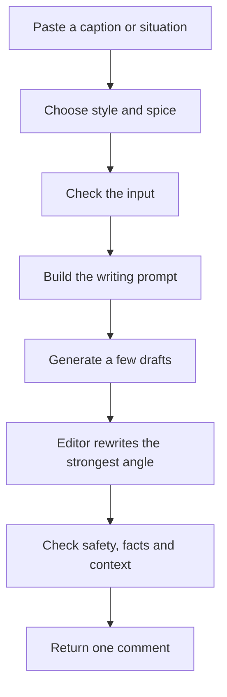

# COOKED


You know sometimes you can't get that comeback or are feeling too perfect. Land here. 

Paste a setup, choose a style, set the spice level (be careful), and get one line you can copy or share. Read the result before posting it.


**Try the [live browser demo](https://cooked.hazar128373-206.workers.dev/).** It runs through Cloudflare Workers AI. The deployment files, setup steps, and provider notes are in [`cloudflare-demo/`](cloudflare-demo/README.md).

[Download the source ZIP](https://github.com/shaikhabdullahwaseem17-byte/COOKED/archive/refs/heads/main.zip) · [Browse the code](https://github.com/shaikhabdullahwaseem17-byte/COOKED)

## What you get

- A simple browser interface with example situations, four writing styles, a 1–5 spice setting, and copy/share buttons.
- **Instagram:** quick, conversational comment-style lines.
- **Dry:** understated, deadpan replies.
- **Desi:** English-language South Asian humour when the situation gives it something real to work with.
- **Absurd:** one strange turn that grows out of a detail in the setup.
- A small FastAPI backend.
- Local model support through Ollama. An OpenAI-compatible provider can also be configured.

The first version included plans for more languages. I cut it back to English because natural phrasing and comic timing mattered more than adding languages I had not properly tested.

## Run it on your computer

You need Python 3.10 or later and [Ollama](https://ollama.com/download). The model runs separately from the app, so the first model download can take a while. Ollama's speed depends on your computer.

### macOS or Linux

Install Ollama first, then open a terminal:

```bash
git clone https://github.com/shaikhabdullahwaseem17-byte/COOKED.git
cd COOKED

python3 -m venv .venv
source .venv/bin/activate

cp .env.example .env
python -m pip install -r requirements.txt

ollama pull qwen2.5:3b
uvicorn app.main:app --reload
```

### Windows PowerShell

Install Ollama and Git, then run:

```powershell
git clone https://github.com/shaikhabdullahwaseem17-byte/COOKED.git
cd COOKED

py -3 -m venv .venv
.\.venv\Scripts\Activate.ps1

Copy-Item .env.example .env
python -m pip install -r requirements.txt

ollama pull qwen2.5:3b
uvicorn app.main:app --reload
```

You can also use GitHub's **Code → Download ZIP** instead of `git clone`. Extract the ZIP, open a terminal in the extracted `COOKED` folder, and continue from the virtual-environment step.

Keep Ollama running. Open **http://127.0.0.1:8000** in your browser. The API documentation is at **http://127.0.0.1:8000/docs**.

There is no account or signup flow in the local app. It runs on your machine. The separate browser demo can be deployed without local Python or Ollama; it uses Cloudflare Workers AI and has its own model and rate limits. See [`cloudflare-demo/README.md`](cloudflare-demo/README.md) for deployment and provider details.

### Model notes

The default is `qwen2.5:3b`, mainly because it is small enough to run on more computers.See the [first editorial review](benchmark-audits/2026-11-16-qwen2.5-3b-editorial-audit.md) and the [later output audit](benchmark-audits/2026-11-16-qwen2.5-3b-output-audit.md).

`gemma4:12b` is another local model being tested. It is not certified as the best model for COOKED, and its results should be judged from the actual comments, not its size or name. To try it, pull it with `ollama pull gemma4:12b` and change `COOKED_MODEL=gemma4:12b` in your `.env` file.

A hosted OpenAI-compatible endpoint is optional. Set `COOKED_PROVIDER=openai_compatible` and fill in the endpoint, model, and key in `.env`. Any provider charges and data-handling terms belong to that provider. You do not need an API key to use the local Ollama setup.

## How a request moves through COOKED



The editor is another model call, not a human. The checks catch some common problems, but they cannot prove that a line is funny or guarantee that every unsafe or irrelevant line will be caught.

## Use the API

Send a POST request to `/api/roast`:

```bash
curl -X POST http://127.0.0.1:8000/api/roast \
  -H "Content-Type: application/json" \
  -d '{"text":"He said quick question and sent a six-paragraph message.","style":"instagram","intensity":3}'
```

The request accepts:
- `text`: English setup, from 3 to 600 characters.
- `style`: `instagram`, `dry`, `desi`, or `absurd`.
- `intensity`: an integer from 1 to 5.

The response contains a `roast` string and the selected `style`.

## What the tests have shown

The two Qwen 2.5 3B reviews show why a completed run is not enough. One run returned all eight comments, but the comments were still weak. A later run returned six of eight. Some lines missed the situation, and one used wording that did not belong in an all-ages app. Both reviews are kept in the repository.

The code was then changed to try different writing angles, let the editor rewrite a draft, and check context, numbers, output format and safety. These checks catch some mistakes. The were fixed.

In the 16 November 2026 checks for the browser redesign, the Python test suite passed with **98 tests**, and the browser demo tests also passed. These results show that the tested code worked as expected. They are not a humour rating. The [human-review guide](HUMAN_REVIEW.md) explains how people can rate humour, context fit, naturalness, originality and safety.

## If COOKED gets it wrong

Tell us. If a line misses the context, sounds painfully robotic, or goes too far, open a [Discussion](https://github.com/shaikhabdullahwaseem17-byte/COOKED/discussions) and show the setup and output. Remove names and private details first. This is also your open-rage room. If the burn's too hard just in case. 

You can also roast the repository back. We can take it as long as your starring it. (pretty pls, this is the most i can do after making COOKED public)

Use [Issues](https://github.com/shaikhabdullahwaseem17-byte/COOKED/issues) for reproducible bugs. Use Discussions for opinions, bad jokes, ideas, and general conversation.

## License

The repository is released under the **MIT License**. You may use it privately or commercially, copy it, modify it, publish it, distribute it, and sell your own version. Keep the copyright notice and include the MIT licence text with copies or substantial portions of the software.

To make your own version, fork the repository or download the ZIP, change the prompts in `app/prompts.py`, adjust the examples in `data/style_examples.jsonl`, and change the page in `app/static/index.html`. Run the tests with:

```bash
pip install -r requirements-dev.txt
pytest -q
```

The MIT licence for this repository does not replace the separate licences and terms for Ollama models, hosted model providers, Python packages, or other third-party software. Check those before redistributing a bundled model or service.

## How I built COOKED, from the beginning

I want the history of this project to be clear. COOKED did not appear as a finished app in one prompt. I made decisions, tested things, rejected parts that were not good enough, and corrected the direction when the work did not match what I had asked for. This section records the main steps and the mistakes I had to catch along the way.

### Starting the project

I created the GitHub repository called COOKED and decided to build the project there. I did the work from my phone using GitHub Codespaces. I had to set up and run the project through the Codespaces interface.

At the beginning, I needed practical instructions. I opened a Codespace, checked the Python environment, ran the commands, and worked through the test output. I asked what the results meant and which files mattered when the test runner showed failures. I kept going through the checks instead of treating a successful-looking as I'm done.

I wanted the work done properly, but I also did not want the core project publication dragged out for days. I aimed for speed without lowering the quality standard. I did not want to keep hearing that something was "strong" while obvious problems were left for later.

### The first model and the quality problem

The first live local benchmark used Ollama with Qwen 2.5 3B and eight English test situations. It returned eight outputs, but that did not mean the comments were good. They were often generic or awkward. Earlier attempts to add Urdu, Hindi and Roman Urdu were also unreliable. The benchmark score was only a debugging signal, not a measure of humour.

I wanted the actual comments judged, not a nice-looking test count. I pushed for better output quality, stronger context fit, more natural wording, and originality. I also stopped relying on a weaker model when the goal was to get the best result we could. I told codex to use a better model directly for the work rather than repeatedly treating the weak default as if it were good enough. The project history should be honest about these.

Different local models were then tried, including larger Qwen and Gemma models. The results were mixed. A bigger model was not automatically funnier, and a generated comment was not automatically worth using. Some runs were slow, some were inconsistent, and some produced lines that still missed the situation. Model size, output count, or a passing test suite were not used as a substitute for reading the actual results.

The default local model is a starting option. It is not a claim that COOKED has reached its humour target. The audit is kept in the repository so people can see the shortcomings instead of blindly trusting. Anyone can bring a bigger better model for themselves and use it. 

### Cutting the language scope back

Codex initially expanded the project to include multiple languages, including Urdu, Hindi, and Roman Urdu. That was not a direction I wanted to keep just for the sake of having more language options. I questioned whether those languages were genuinely good enough, whether they were adding value, and whether they were making the product worse.

I decided to remove that multilingual scope and make the first version English-only. I wanted one language handled naturally rather than spreading thin. I kept the Desi style, but it would be written in English and use South Asian humour when the situation actually supported it. 

The four styles I kept were Instagram, Dry, Desi, and Absurd. I wanted them to feel meaningfully different, not just be four labels.

### Making the humour more relevant

I kept pushing the work away from generic insults and towards comments that actually connect to the situation. A line should use something specific from the caption or scenario. It should sound like a person wrote it, have a clear comic angle, and land without explaining its own joke.

The project gained separate writing angles, draft generation, an editor pass, and checks for context, changed numbers, output shape, and safety. Those changes were developed and tested in stages. I also challenged cases where codex treated a technical improvement as proof that the humour itself had improved. Automated tests can check behaviour and catch regressions, but people still need to judge whether the comments are funny, natural, original, and relevant.

I wanted the safety boundaries to be part of the product too. COOKED is meant for on the go roast comments, not for targeting someone's appearance, identity, health, vulnerabilities, or private information.

### Building a public version

The local project used Ollama and did not require me to provide an API key. I also wanted people to be able to try COOKED in a browser. That led to a separate Cloudflare Workers AI demo. It uses a hosted model and its own request limits, so it is not identical to the local app's multi-draft and editor workflow. I tested the deployed endpoint and tried actual prompts in the browser. The public demo is linked near the top of this README.

The public browser version and the local Python app are separate parts of the project. Changes to the browser interface were kept separate from the Worker generation endpoint so the redesign would not needlessly disturb the working request flow.

### The design was built through real decisions and revisions

I did not want COOKED to look like a ready-made AI landing page. I wanted a focused tool that felt considered, simple to use, and recognisably its own thing. The final design came from trying things, looking at them, rejecting what did not feel right, and asking for specific changes until the page matched what I had in mind.

These were my decisions during the design process:

- I wanted the interface itself, not a marketing page. No generic feature sections, feature cards, three-column grids, circular icon badges, or unnecessary footer sections taking attention away from the tool.
- I chose a pitch-black background, #000000, with clean white typography.
- I wanted one main workspace, not a collection of separate cards. The input and generated comment belong inside the same rounded glass panel, with a fine divider between them.
- I asked for the controls above the panel to be part of the same visual language. The clear and copy controls are compact circles, and the style selector is a rounded pill.
- I chose a smoked-glass look. The panel and controls should be see-through, with a light translucent surface, a subtle silver border, a restrained highlight along the inside top edge, and enough blur to make the glass visible.
- The black page needed a little atmosphere behind the glass. I asked for a very soft, diffuse charcoal-grey haze so the transparency would actually show. It should stay subtle and sit behind the interface.
- I chose the wordmark to be just COOKED, with evenly spaced letters and a clean Swiss-style sans-serif look, using a Helvetica-style font stack. No extra slogan or decorative lettering.
- I wanted the writing area to stay straightforward. The user enters a caption, text, or situation, chooses a style and intensity, and gets a comment in the same workspace.

Blue and purple colour treatments, decorative bubbles, floating water effects, emojis, sparkles, lens flares, swirling light waves, smoke streaks, shiny plastic-looking reflections, and loud sci-fi glow effects were rejected. (🤢).

The design took more than one pass. Some early versions were too plain. Some changes still did not look transparent enough. I pointed that out and asked for the glass on the main panel and the buttons to be adjusted. I also rejected versions that drifted away from the black, restrained look. The final direction was not accepted just because a page had been generated. I reviewed it, said what was wrong, changed the brief, and approved the version that matched the idea.

I asked to see a preview before changing the public app. Once I was happy with the direction, I asked for it to be implemented without damaging the working project. The final browser redesign was made in a separate branch, checked, and merged through a pull request. The change was limited to the browser page. The Worker and its generation endpoint were left alone. The automated browser-demo tests and Python test suite both passed for that change.

### Mistakes and corrections that are part of the record

There were times when the codex's work did not follow my direction closely enough. It added language support I had not decided to keep. It spent time working around a weaker model when I had asked for a better one to be used directly. Some early design attempts were too plain, and later attempts still failed to make the glass look properly transparent. I had to figure out those problems and restate what I wanted.

I also had to keep correcting the difference between a test passing and a product being good. A benchmark returning outputs does not mean the jokes work. A higher test count does not mean the humour is better. A page being generated does not mean it matches the design. I asked for the actual output and actual interface to be reviewed, and for claims to stay within what had really been checked.

I am including these points because they are part of how the project was made. I do not want the README to pretend that every first attempt was right or that the assistant independently made all the decisions. I gave the direction, tested the work, caught mistakes, removed things I did not want, and decided what stayed.

That is how I wanted this project to be made: with a clear idea, real testing, corrections, and no pretending that the first output is automatically good enough. The AI helped write and revise the code, but it did not decide what COOKED should be. I did.

## Who did what

The idea and product direction are the creator's: making a light roasting tool, choosing the English-only scope, deciding how the four styles should sound, setting the quality and safety boundaries, and choosing to release the project openly.

AI assisted with the implementation. It wrote the application code, prompt code, tests, and GitHub Actions workflow files, and helped diagnose test and benchmark failures. GitHub Actions ran the automated checks and reported their results. The creator directed the work, made the product decisions, reviewed the changes, and remains responsible for the project.

COOKED uses existing instruction models. It is not a new foundation model trained by this repository. The examples in `data/style_examples.jsonl` are illustrative examples prepared for the project; they are not scraped Instagram comments.

## Project files

- [Model notes](MODEL_CARD.md)
- [Human-review guide](HUMAN_REVIEW.md)
- [Benchmark audits](benchmark-audits/)
- [Contributing](CONTRIBUTING.md)
- [Code of Conduct](CODE_OF_CONDUCT.md)
- [Security](SECURITY.md)
- [MIT License](LICENSE)
