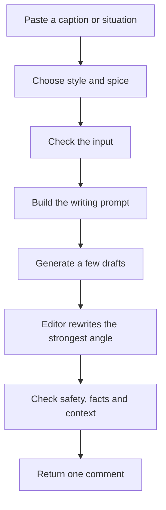

# COOKED

A small English-only app for writing short, playful comments about captions and harmless situations.

Paste a setup, choose a style, set the spice level, and get one line you can copy or share. Sometimes it misses. Read the result before posting it.

**Try the [live browser demo](https://cooked.hazar128373-206.workers.dev/).** It runs through Cloudflare Workers AI. The deployment files, setup steps, and provider notes are in [`cloudflare-demo/`](cloudflare-demo/README.md).

[Download the source ZIP](https://github.com/shaikhabdullahwaseem17-byte/COOKED/archive/refs/heads/main.zip) · [Browse the code](https://github.com/shaikhabdullahwaseem17-byte/COOKED)

## What you get

- A simple browser interface with example situations, four writing styles, a 1–5 spice setting, and copy/share buttons.
- **Instagram:** quick, conversational comment-style lines.
- **Dry:** understated, deadpan replies.
- **Desi:** English-language South Asian humour when the situation gives it something real to work with.
- **Absurd:** one strange turn that grows out of a detail in the setup.
- A small FastAPI backend.
- Local model support through Ollama. An OpenAI-compatible provider can also be configured.

The first version had broader language ambitions. We cut it back to English because natural phrasing and comic timing mattered more than pretending to handle languages we had not tested properly.

## Run it on your computer

You need Python 3.10 or later and [Ollama](https://ollama.com/download). The model runs separately from the app, so the first model download can take a while. Ollama's speed depends on your computer.

### macOS or Linux

Install Ollama first, then open a terminal:

```bash
git clone https://github.com/shaikhabdullahwaseem17-byte/COOKED.git
cd COOKED

python3 -m venv .venv
source .venv/bin/activate

cp .env.example .env
python -m pip install -r requirements.txt

ollama pull qwen2.5:3b
uvicorn app.main:app --reload
```

### Windows PowerShell

Install Ollama and Git, then run:

```powershell
git clone https://github.com/shaikhabdullahwaseem17-byte/COOKED.git
cd COOKED

py -3 -m venv .venv
.\.venv\Scripts\Activate.ps1

Copy-Item .env.example .env
python -m pip install -r requirements.txt

ollama pull qwen2.5:3b
uvicorn app.main:app --reload
```

You can also use GitHub's **Code → Download ZIP** instead of `git clone`. Extract the ZIP, open a terminal in the extracted `COOKED` folder, and continue from the virtual-environment step.

Keep Ollama running. Open **http://127.0.0.1:8000** in your browser. The API documentation is at **http://127.0.0.1:8000/docs**.

There is no account or signup flow in the local app. It runs on your machine. The separate browser demo can be deployed without local Python or Ollama; it uses Cloudflare Workers AI and has its own model and rate limits. See [`cloudflare-demo/README.md`](cloudflare-demo/README.md) for deployment and provider details.

### Model notes

The default is `qwen2.5:3b`, mainly because it is a relatively light starting point. It has **not** met the humour target. In the first eight-case check it returned six comments, and the editorial review found several weak or poorly matched lines. See the [Qwen 2.5 3B audit](benchmark-audits/2026-11-16-qwen2.5-3b-output-audit.md).

`gemma4:12b` is being tested as a higher-capacity alternative. It is not certified as the best model for COOKED, and its results should be judged from the actual comments—not its size or name. To try it, pull it with `ollama pull gemma4:12b` and change `COOKED_MODEL=gemma4:12b` in your `.env` file.

A hosted OpenAI-compatible endpoint is optional. Set `COOKED_PROVIDER=openai_compatible` and fill in the endpoint, model, and key in `.env`. Any provider charges and data-handling terms belong to that provider. You do not need an API key to use the local Ollama setup.

## How a request moves through COOKED



The editor is another model call, not a human. The checks catch some common problems, but they cannot prove that a line is funny or guarantee that every unsafe or irrelevant line will be caught.

## Use the API

Send a POST request to `/api/roast`:

```bash
curl -X POST http://127.0.0.1:8000/api/roast \
  -H "Content-Type: application/json" \
  -d '{"text":"He said quick question and sent a six-paragraph message.","style":"instagram","intensity":3}'
```

The request accepts:
- `text`: English setup, from 3 to 600 characters.
- `style`: `instagram`, `dry`, `desi`, or `absurd`.
- `intensity`: an integer from 1 to 5.

The response contains a `roast` string and the selected `style`.

## What we learned while making it

The first live run was a useful reality check. Qwen 2.5 3B returned 6 of 8 test cases. Some lines were generic, some wandered away from the situation, and one used wording that did not belong in an all-ages app. We kept the audit in the repository rather than presenting the run as a success.

That review led to several changes: separate writing angles, an editor that can rewrite rather than only pick a draft, checks for changed numbers and unrelated details, and broader output-safety tests. The test suite also caught regressions while those changes were being made.

As of **16 November 2026**, the latest verified GitHub Actions test run reported **98 passing tests**. That means the tested code paths passed; it is not a 4/5 humour rating. The live benchmark and independent human ratings are separate measures. The [human-review guide](HUMAN_REVIEW.md) explains how to rate humour, context fit, naturalness, originality, and safety without seeing which model wrote each line.

## If COOKED gets it wrong

Tell us. If a line misses the context, sounds painfully robotic, or goes too far, open a [Discussion](https://github.com/shaikhabdullahwaseem17-byte/COOKED/discussions) and show the setup and output. Remove names and private details first.

You can also roast the repository back. We can take it.

Use [Issues](https://github.com/shaikhabdullahwaseem17-byte/COOKED/issues) for reproducible bugs. Use Discussions for opinions, bad jokes, ideas, and general conversation.

## Copy it, change it, sell your version

The repository is released under the **MIT License**. You may use it privately or commercially, copy it, modify it, publish it, distribute it, and sell your own version. Keep the copyright notice and include the MIT licence text with copies or substantial portions of the software.

To make your own version, fork the repository or download the ZIP, change the prompts in `app/prompts.py`, adjust the examples in `data/style_examples.jsonl`, and change the page in `app/static/index.html`. Run the tests with:

```bash
pip install -r requirements-dev.txt
pytest -q
```

The MIT licence for this repository does not replace the separate licences and terms for Ollama models, hosted model providers, Python packages, or other third-party software. Check those before redistributing a bundled model or service.

## The design was built through real decisions and revisions

I did not want COOKED to look like a ready-made AI landing page. I wanted a focused tool that felt considered, simple to use, and recognisably its own thing. The final design came from trying things, looking at them, rejecting what did not feel right, and asking for specific changes until the page matched what I had in mind.

These were my decisions during the design process:

- I wanted the interface itself, not a marketing page. No generic feature sections, feature cards, three-column grids, circular icon badges, or unnecessary footer sections taking attention away from the tool.
- I chose a pitch-black background, #000000, with clean white typography.
- I wanted one main workspace, not a collection of separate cards. The input and generated comment belong inside the same rounded glass panel, with a fine divider between them.
- I asked for the controls above the panel to be part of the same visual language. The clear and copy controls are compact circles, and the style selector is a rounded pill.
- I chose a smoked-glass look. The panel and controls should be see-through, with a light translucent surface, a subtle silver border, a restrained highlight along the inside top edge, and enough blur to make the glass visible.
- The black page needed a little atmosphere behind the glass. I asked for a very soft, diffuse charcoal-grey haze so the transparency would actually show. It should stay subtle and sit behind the interface.
- I chose the wordmark to be just COOKED, with evenly spaced letters and a clean Swiss-style sans-serif look, using a Helvetica-style font stack. No extra slogan or decorative lettering.
- I wanted the writing area to stay straightforward. The user enters a caption, text, or situation, chooses a style and intensity, and gets a comment in the same workspace.

There were also things I specifically did not want. I rejected blue and purple colour treatments, decorative bubbles, floating water effects, emojis, sparkles, lens flares, swirling light waves, smoke streaks, shiny plastic-looking reflections, and loud sci-fi glow effects. I did not want the glass to become a collection of glowing decorations. The smoke is only a soft background haze, not an effect layered over the controls.

The design took more than one pass. Some early versions were too plain. Some changes still did not look transparent enough. I pointed that out and asked for the glass on the main panel and the buttons to be adjusted. I also rejected versions that drifted away from the black, restrained look. The final direction was not accepted just because a page had been generated. I reviewed it, said what was wrong, changed the brief, and approved the version that matched the idea.

I asked to see a preview before changing the public app. Once I was happy with the direction, I asked for it to be implemented without damaging the working project. The final browser redesign was made in a separate branch, checked, and merged through a pull request. The change was limited to the browser page. The Worker and its generation endpoint were left alone. The automated browser-demo tests and Python test suite both passed for that change.

That is how I wanted this project to be made: with a clear idea, a lot of small decisions, honest review, and no pretending that the first output is automatically good enough. The AI helped write and revise the code, but it did not decide what I wanted COOKED to look like. I did.

## Who did what

The idea and product direction are the creator's: making a playful roasting tool, choosing the English-only scope, deciding how the four styles should sound, setting the quality and safety boundaries, and choosing to release the project openly.

AI assisted with the implementation. It generated most of the application code, prompt code, tests, and GitHub Actions workflow files, and helped diagnose test and benchmark failures. GitHub Actions ran the automated checks and reported their results. The creator directed the work, made the product decisions, reviewed the changes, and remains responsible for the project.

COOKED uses existing instruction models. It is not a new foundation model trained by this repository. The examples in `data/style_examples.jsonl` are illustrative examples prepared for the project; they are not scraped Instagram comments.

## Project files

- [Model notes](MODEL_CARD.md)
- [Human-review guide](HUMAN_REVIEW.md)
- [Benchmark audits](benchmark-audits/)
- [Contributing](CONTRIBUTING.md)
- [Code of Conduct](CODE_OF_CONDUCT.md)
- [Security](SECURITY.md)
- [MIT License](LICENSE)
